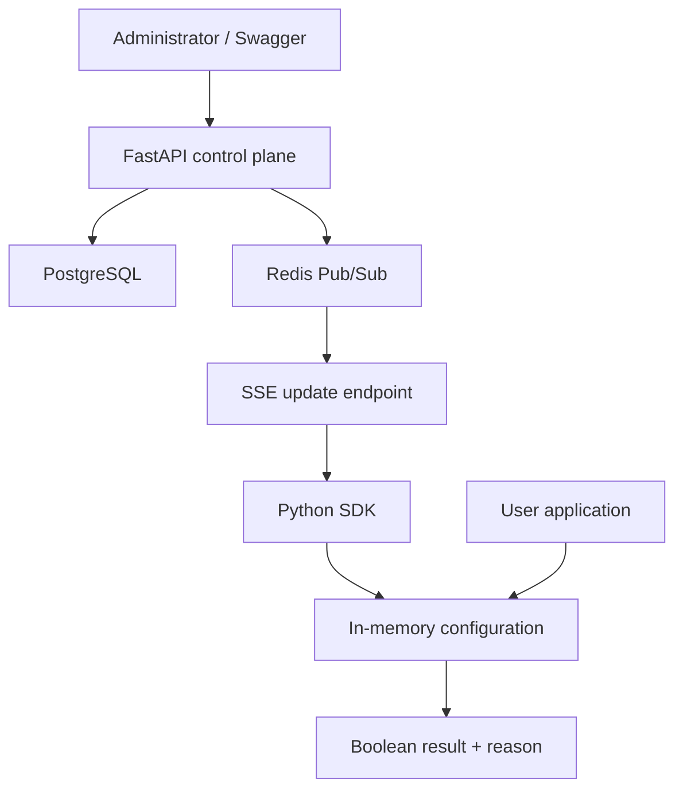

Yes—build **FlagForge**.

For your profile, it is a better second project than another RAG application. Your notification engine already demonstrates queues, workers, retries, DLQs, rate limiting, monitoring, and throughput. FlagForge adds different and valuable engineering concepts:

* Control plane versus data plane
* Multi-tenant isolation
* Deterministic hashing
* Local SDK evaluation
* Immutable versioned configuration
* Real-time streaming
* Cache consistency
* Failure recovery
* SDK design and benchmarking

It is not an A/B experimentation platform. It is a **feature flag and progressive rollout platform**.

---

# 1. What does this project actually do?

Suppose a company has a new checkout page, but it does not want to release it to every user immediately.

Without FlagForge, the application might contain:

```python
if user.country == "IN":
    show_new_checkout()
```

Changing that behaviour requires modifying code and deploying the application again.

With FlagForge:

```python
enabled = flagforge.evaluate(
    flag_key="new_checkout",
    user={
        "key": "user-981",
        "country": "IN",
    },
    default=False,
)

if enabled:
    show_new_checkout()
else:
    show_old_checkout()
```

An administrator can then configure:

> Enable `new_checkout` for 15% of users whose country is India.

The application does not contact FlagForge for every evaluation. The SDK downloads the configuration and evaluates it locally in memory.

That distinction is central:

* FlagForge server manages configuration.
* The Python SDK makes runtime decisions.
* Redis and SSE inform SDKs when configuration changes.
* PostgreSQL remains the source of truth.

---

# 2. High-level architecture



There are two logical paths.

## Control plane

Used relatively infrequently by administrators:

```text
Create tenant → Create project → Create environment
→ Create flag → Add targeting rules → Publish configuration
```

## Data plane

Used repeatedly by the application:

```text
Application calls SDK evaluate()
→ SDK reads local in-memory configuration
→ SDK evaluates ordered rules
→ SDK returns boolean result
```

The data plane should not query PostgreSQL, Redis, or FastAPI during each evaluation.

That is what makes the project interesting.

---

# 3. Recommended technology stack

Stay entirely in Python.

| Component              | Choice                           |
| ---------------------- | -------------------------------- |
| Control plane          | FastAPI                          |
| Validation             | Pydantic                         |
| ORM                    | SQLAlchemy 2.x                   |
| Database migrations    | Alembic                          |
| Database               | PostgreSQL                       |
| Change notifications   | Redis Pub/Sub                    |
| Live SDK connection    | SSE                              |
| Python HTTP client     | `httpx`                          |
| SDK evaluation         | Plain Python                     |
| Unit tests             | pytest                           |
| Integration tests      | pytest + Docker services         |
| Benchmarking           | `pytest-benchmark` or `pyperf`   |
| Local environment      | Docker Compose                   |
| Initial administration | Swagger UI                       |
| Optional UI            | FastAPI templates + minimal HTML |

FastAPI now provides native SSE support, while `redis-py` supports asynchronous Pub/Sub. Redis must be treated as a notification mechanism, not permanent storage, because a disconnected subscriber can miss Pub/Sub messages. [FastAPI SSE documentation](https://fastapi.tiangolo.com/tutorial/server-sent-events/), [redis-py asynchronous Pub/Sub example](https://redis.readthedocs.io/en/stable/examples/asyncio_examples.html)

---

# 4. Recommended repository structure

Use one GitHub repository but keep the SDK as a separate installable package.

```text
flagforge/
├── control-plane/
│   ├── app/
│   │   ├── api/
│   │   ├── core/
│   │   ├── db/
│   │   ├── models/
│   │   ├── schemas/
│   │   ├── services/
│   │   ├── streaming/
│   │   └── main.py
│   ├── migrations/
│   ├── tests/
│   ├── Dockerfile
│   └── pyproject.toml
│
├── python-sdk/
│   ├── flagforge/
│   │   ├── client.py
│   │   ├── evaluator.py
│   │   ├── models.py
│   │   ├── hashing.py
│   │   └── streaming.py
│   ├── tests/
│   └── pyproject.toml
│
├── demo-app/
│   └── main.py
│
├── benchmarks/
│   ├── evaluation_benchmark.py
│   └── rollout_distribution.py
│
├── compose.yaml
├── README.md
└── .env.example
```

This remains a modular monolith—not microservices.

---

# 5. Build it incrementally

Because you prefer learning concepts when you encounter them, do not study everything first. Use the following milestone sequence.

---

## Milestone 0: Understand feature-flag semantics

Before writing code, define the behaviour precisely.

A boolean flag should contain:

```json
{
  "key": "new_checkout",
  "enabled": true,
  "default_value": false,
  "rules": [
    {
      "priority": 1,
      "conditions": [
        {
          "attribute": "country",
          "operator": "equals",
          "value": "IN"
        }
      ],
      "serve": {
        "type": "percentage",
        "true_percentage": 15
      }
    }
  ]
}
```

Evaluation procedure:

1. Find the flag.
2. If the flag is globally disabled, return its disabled/default value.
3. Sort rules by priority.
4. Evaluate rules in order.
5. The first matching rule wins.
6. If that rule contains a fixed value, return it.
7. If it contains a percentage rollout, hash the user deterministically.
8. If no rule matches, return the default value.

Study:

* What feature flags are
* Progressive rollout versus experimentation
* Control plane versus data plane
* First-match-wins rule engines
* What “deterministic” means

Deliverable: a one-page `DESIGN.md` describing these semantics before implementation.

---

## Milestone 1: Basic FastAPI control plane

Start without Redis, SSE, percentage rollouts, or an SDK.

Implement:

* Create tenant
* Create project under tenant
* Create environment under project
* Create boolean flag under environment
* Read and update flags
* List flags

Hierarchy:

```text
Tenant
└── Project
    ├── Development
    ├── Staging
    └── Production
```

For example:

```text
Tenant: Acme
Project: ecommerce
Environment: production
Flag: new_checkout
```

Suggested endpoints:

```text
POST   /api/v1/tenants
POST   /api/v1/tenants/{tenant_id}/projects
POST   /api/v1/projects/{project_id}/environments

POST   /api/v1/environments/{environment_id}/flags
GET    /api/v1/environments/{environment_id}/flags
GET    /api/v1/environments/{environment_id}/flags/{flag_key}
PATCH  /api/v1/environments/{environment_id}/flags/{flag_key}
DELETE /api/v1/environments/{environment_id}/flags/{flag_key}
```

Important multi-tenancy rule:

> Every query for a project, environment, flag, or rule must be scoped through the tenant.

Never fetch a flag merely using:

```python
session.get(Flag, flag_id)
```

Use something equivalent to:

```sql
WHERE flag.id = :flag_id
  AND environment.project.tenant_id = :authenticated_tenant_id
```

Study:

* REST resource modelling
* SQLAlchemy relationships
* Foreign keys and unique constraints
* Alembic migrations
* Multi-tenant row isolation
* Pydantic request/response schemas

Deliverable: CRUD works through Swagger and is tested against PostgreSQL.

---

## Milestone 2: Design the PostgreSQL schema

A reasonable initial schema:

### `tenants`

```text
id
name
created_at
```

### `projects`

```text
id
tenant_id
name
key
created_at
```

Unique:

```text
(tenant_id, key)
```

### `environments`

```text
id
project_id
name
key
current_version
created_at
```

Unique:

```text
(project_id, key)
```

### `sdk_keys`

```text
id
environment_id
key_prefix
key_hash
created_at
revoked_at
```

Store only the hash of an SDK key, not the complete key.

### `feature_flags`

```text
id
environment_id
key
name
enabled
default_value
created_at
updated_at
```

Unique:

```text
(environment_id, key)
```

### `targeting_rules`

```text
id
flag_id
priority
conditions JSONB
serve_value BOOLEAN nullable
rollout_percentage INTEGER nullable
created_at
```

Use basis points rather than floating-point percentages:

```text
15% = 1500
30% = 3000
100% = 10000
```

### `configuration_versions`

```text
id
environment_id
version
configuration JSONB
created_at
created_by
```

Unique:

```text
(environment_id, version)
```

Each row should contain an immutable, complete snapshot of the environment configuration.

Study:

* Composite unique constraints
* JSONB
* Normalized tables versus denormalized snapshots
* Immutable configuration
* Transactions
* Optimistic concurrency

SQLAlchemy supports version counters for detecting conflicting updates, although you can also manage an environment version explicitly. [SQLAlchemy version-counter documentation](https://docs.sqlalchemy.org/en/latest/orm/versioning.html)

---

## Milestone 3: Ordered targeting rules

Initially support only a few useful operators:

```text
equals
not_equals
in
not_in
```

Supported attributes:

```text
key
country
plan
email
```

Also allow arbitrary custom attributes:

```python
user = {
    "key": "user-123",
    "country": "IN",
    "plan": "premium",
    "company_size": 500,
}
```

A rule can contain multiple conditions. Conditions within one rule should use `AND`.

Example:

```json
{
  "priority": 10,
  "conditions": [
    {
      "attribute": "country",
      "operator": "equals",
      "value": "IN"
    },
    {
      "attribute": "plan",
      "operator": "equals",
      "value": "premium"
    }
  ],
  "serve_value": true
}
```

Semantics:

```text
Rule 1 matches? Use Rule 1 result.
Otherwise Rule 2 matches? Use Rule 2 result.
Otherwise use default.
```

Validation requirements:

* Priorities must be unique within one flag.
* A rule must specify either a fixed boolean or a rollout, not both.
* Percentage must be between `0` and `10000`.
* A condition must use a supported operator.
* Every flag key must be unique per environment.

Study:

* Rule-engine design
* Precedence and short-circuiting
* Schema validation
* Strategy pattern, but only if it makes the operators cleaner

Deliverable: rules can be created via API, but evaluation may still happen on the server temporarily.

---

## Milestone 4: Deterministic percentage rollout

This is one of the most important parts of the project.

Never use:

```python
random.random() < 0.15
```

That could return a different result on every evaluation.

Use a stable hash:

```python
import hashlib


def rollout_bucket(
    environment_key: str,
    flag_key: str,
    user_key: str,
) -> int:
    identity = f"{environment_key}:{flag_key}:{user_key}"
    digest = hashlib.sha256(identity.encode()).digest()
    number = int.from_bytes(digest[:8], byteorder="big")
    return number % 10_000
```

Then:

```python
enabled = rollout_bucket(...) < 1500
```

This provides:

* Same flag + same environment + same user → same bucket
* Different flag → independently distributed bucket
* `0–1499` → enabled at 15%
* `0–2999` → enabled at 30%

This also creates a valuable property: when rollout grows from 15% to 30%, users in the original 15% remain enabled. Another 15% is added.

Tests:

```python
def test_same_user_gets_same_bucket():
    ...

def test_bucket_is_between_0_and_9999():
    ...

def test_15_percent_cohort_is_subset_of_30_percent():
    ...

def test_different_flags_use_independent_buckets():
    ...
```

Distribution test:

* Generate at least 100,000 synthetic user keys.
* Evaluate a 15% rollout.
* Report the observed enabled percentage.
* Repeat for 30%, 50%, and 90%.

Do not require exactly 15%; verify that it is close within a defensible tolerance.

Study:

* Cryptographic hashes
* Uniform distribution
* Modulo bucketing
* Stable identifiers
* Monotonic rollout expansion
* Statistical sampling error at a basic level

---

## Milestone 5: Compile versioned configuration snapshots

Do not make the SDK understand your relational database structure.

Compile all flags and rules for an environment into one SDK-facing JSON document:

```json
{
  "environment": "production",
  "version": 7,
  "generated_at": "2026-08-20T12:30:00Z",
  "flags": {
    "new_checkout": {
      "enabled": true,
      "default_value": false,
      "rules": [
        {
          "id": "india-rollout",
          "priority": 1,
          "conditions": [
            {
              "attribute": "country",
              "operator": "equals",
              "value": "IN"
            }
          ],
          "rollout": {
            "true_basis_points": 1500
          }
        }
      ]
    }
  }
}
```

Every successful configuration change should perform this sequence:

```text
Begin PostgreSQL transaction
→ Update editable tables
→ Increment environment version
→ Compile complete snapshot
→ Insert configuration_versions row
→ Commit
```

Only after the transaction commits should you publish the Redis notification.

Why snapshot the complete configuration?

* The SDK needs one consistent document.
* It must not observe half-updated rules.
* Older versions remain inspectable.
* Debugging becomes easier.
* The SDK can atomically replace version 6 with version 7.

Useful endpoint:

```text
GET /sdk/v1/config
Authorization: Bearer <environment-sdk-key>
```

Response:

```json
{
  "version": 7,
  "flags": {}
}
```

You are implementing configuration history, not automatic rollback.

Study:

* Atomic transactions
* Consistent snapshots
* Immutable data
* Optimistic concurrency
* Lost-update problems

---

## Milestone 6: Environment-specific SDK keys

Create separate keys for development, staging, and production.

Example:

```text
ff_sdk_prod_a8c2f9...
```

Secure implementation:

1. Generate 32 random bytes using `secrets.token_urlsafe`.
2. Show the complete key only once.
3. Store a short visible prefix.
4. Store a SHA-256/HMAC hash of the full key.
5. Authenticate SDK requests by hashing the presented key.
6. Resolve exactly one environment from the key.

SDK keys should only read configuration and subscribe to updates. They should not edit flags.

You may use one simple administrator API key for control-plane endpoints. Do not build a complete login system.

Study:

* Authentication versus authorization
* Secret generation
* Hashing API keys
* Constant-time comparison
* Least privilege
* Key revocation

Deliverable: a production SDK key cannot read development or another tenant’s configuration.

---

## Milestone 7: Build the separate Python SDK

The SDK should feel like a real library:

```python
from flagforge import FlagForgeClient, User

client = FlagForgeClient(
    sdk_key="ff_sdk_prod_...",
    base_url="http://localhost:8000",
)

client.start()

result = client.evaluate(
    "new_checkout",
    User(
        key="user-123",
        attributes={"country": "IN"},
    ),
    default=False,
)

print(result.value)
print(result.reason)
print(result.configuration_version)
```

Suggested API:

```python
@dataclass(frozen=True)
class EvaluationResult:
    value: bool
    reason: str
    rule_id: str | None
    bucket: int | None
    configuration_version: int | None
    error: str | None
```

Evaluation reasons:

```text
RULE_MATCH
PERCENTAGE_ROLLOUT
DEFAULT_VALUE
FLAG_DISABLED
FLAG_NOT_FOUND
USER_KEY_MISSING
TYPE_MISMATCH
SDK_NOT_READY
INVALID_CONFIGURATION
```

SDK internal state:

```python
class FlagForgeClient:
    _configuration: Configuration | None
    _configuration_lock: threading.Lock
    _stop_event: threading.Event
    _update_thread: threading.Thread
```

The evaluation path should:

* Read the current immutable configuration reference.
* Never make a network call.
* Never mutate configuration.
* Return the supplied fallback if no valid configuration exists.
* Include a reason useful for debugging.

When receiving a newer configuration:

```text
Download and validate new snapshot
→ Build new immutable object
→ Acquire lock briefly
→ Replace old configuration reference
→ Release lock
```

Never clear the old configuration before the new one has been fully downloaded and validated.

Study:

* Packaging a Python library
* Threads versus asyncio
* Thread-safe state
* Immutability
* Public API design
* Semantic versioning
* Context managers and graceful shutdown

For the first SDK, a background thread is easier for users because both synchronous FastAPI and ordinary Python applications can use it.

---

## Milestone 8: Redis Pub/Sub and SSE

When an administrator changes a flag:

```text
PostgreSQL commits version 8
→ FastAPI publishes {"environment_id": "...", "version": 8}
→ Redis subscribers receive it
→ SSE connection sends a version-change event
→ SDK downloads version 8
→ SDK atomically replaces version 7
```

Use Redis channels such as:

```text
flagforge:environment:{environment_id}
```

Example SSE event:

```text
event: configuration.updated
id: 8
data: {"version": 8}
```

Do not send the entire configuration through Redis. Redis should carry only an invalidation/version notification.

Do not necessarily send the entire configuration through SSE either. SSE can tell the SDK that version 8 exists, after which the SDK fetches the authenticated snapshot.

This keeps responsibilities clean:

* PostgreSQL: source of truth
* Redis: cross-instance notification
* SSE: server-to-SDK delivery
* Configuration endpoint: actual snapshot
* SDK memory: local evaluation source

Important reliability point:

> Redis Pub/Sub is ephemeral. If a subscriber is disconnected, it can miss an event.

Therefore, the SDK must:

1. Fetch the latest configuration during startup.
2. Listen for SSE events.
3. Reconnect with exponential backoff.
4. Fetch the latest version after every reconnection.
5. Optionally poll every 30–60 seconds as a reconciliation fallback.
6. Ignore events with versions older than or equal to its current version.

Use SSE rather than WebSockets because updates are primarily server-to-client. FastAPI can stream SSE events directly, and Compose health checks can ensure PostgreSQL and Redis are ready before the API starts. [FastAPI SSE documentation](https://fastapi.tiangolo.com/tutorial/server-sent-events/), [Docker Compose startup-order documentation](https://docs.docker.com/compose/how-tos/startup-order/)

Study:

* SSE protocol
* Long-lived HTTP connections
* Heartbeats
* Client reconnection
* Redis Pub/Sub semantics
* Event loss and eventual reconciliation
* Backpressure
* Graceful cancellation

---

## Milestone 9: Last-known-good behaviour

This is another major interview feature.

Suppose the SDK currently holds version 8. Then:

* Redis stops.
* FastAPI stops.
* PostgreSQL stops.
* The application continues running.

Evaluations must continue using version 8.

Rules:

```text
Network failure during update:
    Keep old configuration.

Invalid JSON/configuration:
    Keep old configuration.

SSE disconnection:
    Keep old configuration and reconnect.

Server unavailable at initial startup:
    Return caller-provided default until first valid snapshot.

Server unavailable after successful startup:
    Continue using last-known-good configuration.
```

Expose SDK status:

```python
status = client.status()

print(status.ready)
print(status.configuration_version)
print(status.last_updated_at)
print(status.stream_connected)
print(status.last_error)
```

For the required demonstration, in-memory last-known-good is sufficient. Disk persistence across application restarts can remain a stretch goal.

Study:

* Fail-safe defaults
* Graceful degradation
* Retry with exponential backoff and jitter
* Stale-but-available data
* Atomic state replacement
* Availability versus consistency

---

## Milestone 10: Tests

Divide testing into four categories.

### Unit tests

Test pure logic:

* Operators
* Ordered rule selection
* Missing attributes
* Deterministic hashing
* Fixed boolean rules
* Percentage rules
* Default values
* Evaluation reasons
* Invalid configuration rejection

These tests should not require Docker.

### Repository/API tests

Test:

* Tenant isolation
* Duplicate flag keys
* SDK-key authentication
* Version increments
* Configuration snapshots
* Rule validation
* Concurrent updates

### Integration tests

Run PostgreSQL and Redis and test:

```text
Create flag
→ SDK downloads version 1
→ Update flag
→ Redis publishes change
→ SSE delivers change
→ SDK receives version 2
→ Evaluation changes without restart
```

### Resilience tests

Test:

* Redis disconnected
* SSE disconnected
* FastAPI unavailable
* Invalid newer configuration
* Duplicate events
* Events delivered out of order
* Reconnection after missed updates
* Evaluation while configuration is being swapped

A particularly impressive test:

```text
Run thousands of evaluations concurrently
while repeatedly replacing the configuration.
Assert that every result came entirely from one valid version.
```

Study:

* pytest fixtures
* Dependency overrides in FastAPI
* Integration-test isolation
* Concurrency testing
* Testcontainers, or Compose-based test services
* Property-based testing with Hypothesis as an optional enhancement

---

## Milestone 11: Benchmarking

Benchmark only the local SDK evaluator—not a server endpoint—and clearly state the hardware and methodology.

Measure:

* Median/p50 evaluation latency
* p95
* p99
* Throughput in evaluations per second
* Evaluation with no rules
* Evaluation with 1 rule
* Evaluation with 10 ordered rules
* Evaluation with percentage rollout
* Performance with 1, 10, 100 and 1,000 flags in configuration

Example benchmark cases:

```text
Flag exists, fixed value
First rule matches
Last of 10 rules matches
No rule matches
15% percentage rollout
Missing flag
```

Also create a rollout distribution report:

| Configured rollout | Sample users | Observed enabled |
| -----------------: | -----------: | ---------------: |
|                15% |      100,000 |   measured value |
|                30% |      100,000 |   measured value |
|                50% |      100,000 |   measured value |

Do not write “microsecond latency” in your resume before measuring it.

Report something like:

> On an Intel/AMD X CPU using Python X.Y, local evaluation achieved measured p50 X µs and p99 Y µs across 100,000 evaluations.

Study:

* Warm-up iterations
* `time.perf_counter_ns`
* Percentiles
* Avoiding I/O in benchmarks
* Repeatability
* Benchmark environment disclosure

---

## Milestone 12: Docker Compose and demonstration

Compose services:

```text
api
postgres
redis
demo-app
```

You do not need separate worker or SSE microservices.

Use:

* PostgreSQL health check with `pg_isready`
* Redis health check with `redis-cli ping`
* `depends_on` with `service_healthy`
* Named PostgreSQL volume
* Environment variables through `.env`
* Alembic migration during startup or a separate one-shot migration service

Docker Compose supports waiting for dependencies marked `service_healthy`, which avoids the common problem where the API starts before PostgreSQL is ready. [Docker Compose services reference](https://docs.docker.com/reference/compose-file/services/)

Target experience:

```bash
docker compose up --build
```

Then the reviewer opens:

```text
http://localhost:8000/docs
```

---

# 6. Exact final demonstration

Create a scripted demo application that evaluates 20 fixed users every two seconds.

## Initial state

```text
new_checkout = false
configuration version = 1
```

The demo output:

```text
user-001 country=IN new_checkout=False reason=DEFAULT_VALUE version=1
```

## Enable 15% for Indian users

Using Swagger:

```text
country equals IN
true rollout = 1500 basis points
default = false
```

Server creates version 2.

The SDK logs:

```text
SSE event received: version=2
Configuration updated: 1 → 2
```

Show that:

* Non-Indian users remain false.
* Approximately 15% of a large Indian sample are true.
* Repeated evaluation of the same user produces the same result.

## Increase to 30%

Server creates version 3.

Show that:

* SDK updates without restarting.
* Original 15% remain enabled.
* More Indian users become enabled.
* Approximately 30% of the large sample are now true.

## Stop the server

```bash
docker compose stop api redis
```

The demo application should log:

```text
SSE disconnected; retrying in 2.1 seconds
Continuing with last-known-good configuration version 3
```

Evaluations should continue successfully.

Finally run:

```bash
pytest
python benchmarks/evaluation_benchmark.py
python benchmarks/rollout_distribution.py
```

This demonstrates the complete engineering story.

---

# 7. Suggested eight-week schedule

| Week | Build                                  | Study                                  |
| ---- | -------------------------------------- | -------------------------------------- |
| 1    | Tenants, projects, environments, flags | Multi-tenancy, SQLAlchemy, Alembic     |
| 2    | Rules and server-side evaluator        | Rule engines, validation, precedence   |
| 3    | Deterministic rollout                  | Hashing, bucketing, distribution       |
| 4    | Versioned configuration snapshots      | Transactions, consistency, concurrency |
| 5    | SDK keys and Python SDK                | Security, packaging, thread safety     |
| 6    | Redis + SSE updates                    | Pub/Sub, streaming, reconnection       |
| 7    | LKG resilience and tests               | Failure handling, integration testing  |
| 8    | Benchmarks, Compose, demo, README      | Performance methodology, documentation |

A strong working version can be built in 6–8 weeks at roughly 8–10 focused hours per week. Do not attempt every advanced concern in week one.

---

# 8. What not to spend time on

Do not add:

* RAG or an LLM
* Statistical experiment analysis
* React
* JavaScript backend
* Kubernetes
* Kafka
* RabbitMQ
* Multiple deployable microservices
* Multiple SDK languages
* Billing
* Role-based enterprise dashboards
* Automatic rollback
* Global edge evaluation

Those would dilute the central story.

Swagger is enough for the first complete version. After everything works, you can create one minimal server-rendered page containing:

* Flag name
* Enabled/disabled toggle
* Country
* Rollout percentage
* Save button
* Current configuration version

---

# 9. What interviewers should be able to ask you

Your implementation should let you answer these confidently:

* Why is evaluation local rather than server-side?
* Why use Redis if PostgreSQL already stores configurations?
* What happens when Redis loses a message?
* Why use SSE instead of WebSockets?
* How do you ensure the same user receives the same variation?
* What happens when rollout changes from 15% to 30%?
* How do you prevent cross-tenant access?
* How do you replace configuration safely while evaluations are running?
* What happens if the server goes down?
* Why store immutable snapshots?
* How do you prevent two administrators from overwriting each other?
* What exactly did your benchmark measure?

These are much stronger system-design discussions than “I integrated an LLM API.”

---

# 10. Resume presentation

Eventually describe it approximately like this, replacing placeholders with real measurements:

> **FlagForge — Multi-Tenant Feature Flag and Progressive Rollout Platform**
> Built a FastAPI/PostgreSQL control plane and independent Python SDK supporting ordered targeting rules, deterministic percentage rollouts, environment-scoped SDK keys, and local in-memory evaluation. Implemented immutable versioned configuration snapshots and Redis Pub/Sub–driven SSE updates, allowing applications to receive configuration changes without restarting while retaining last-known-good behaviour during outages. Benchmarked local evaluation at p50/p95/p99 latency and validated rollout distribution across 100,000 synthetic users.

Your best starting point is **Milestone 0 followed by Milestone 1 only**. Do not begin with Redis or SSE. First make the tenant → project → environment → boolean flag hierarchy work correctly in PostgreSQL and Swagger.
